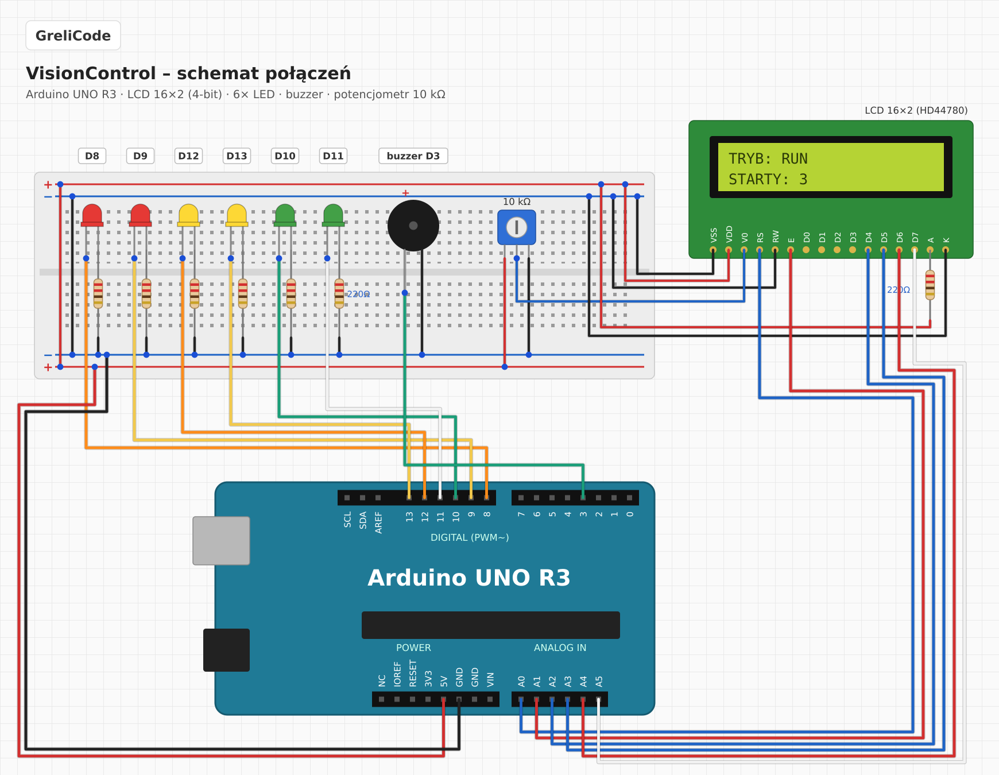
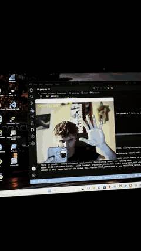

# ✋ VisionControl - sterowanie Arduino gestami dłoni

<p>Projekt hobbystyczny łączący wizję komputerową z elektroniką. Kamera w laptopie śledzi dłoń (MediaPipe Hand Landmarker), skrypt w Pythonie liczy wyprostowane palce i zamienia gest na polecenie wysyłane przez port szeregowy do Arduino UNO. Arduino przełącza tryb pracy, zapala odpowiednie diody LED, odtwarza dźwięk na buzzerze i pokazuje stan na wyświetlaczu LCD 16×2.</p>

<p align="center">
  
</p>

---

## Table of Contents

- [Overview](#overview)
- [Features](#features)
- [Hardware](#hardware)
- [Wiring](#wiring)
- [Libraries](#libraries)
- [Program logic](#program-logic)
- [Installation](#installation)
- [Usage](#usage)
- [Media](#media)

---

## Overview

<p>
Układ działa jak prosty panel sterowania maszyną, obsługiwany bez dotykania: gest <b>START</b> uruchamia „maszynę”, <b>STOP</b> ją zatrzymuje i włącza alarm, a <b>RESET</b> zeruje licznik uruchomień. Python odpowiada za rozpoznawanie gestów, a Arduino za sygnalizację stanu.
</p>

```
Kamera ──► Python (OpenCV + MediaPipe) ──► USB / Serial 9600 ──► Arduino UNO ──► LED / buzzer / LCD
```

---

## Features

### ✋ Feature 1 - Rozpoznawanie gestów
| Gest | Liczba palców | Polecenie (Serial) | Reakcja Arduino |
|------|:---:|:---:|------|
| START | 1 | `1` | zielone LED, LCD `TRYB: RUN`, licznik startów +1, krótki sygnał |
| STOP  | 2 | `0` | czerwone LED, LCD `TRYB: STOP`, ciągły sygnał buzzera |
| RESET | 5 | `R` | żółte LED, LCD `TRYB: RESET`, wyzerowanie licznika, dłuższy sygnał |

### 🛡️ Feature 2 - Odporność na przypadkowe gesty
<p>Gest musi być trzymany stabilnie przez 0,5 s, zanim polecenie zostanie wysłane, i jest wysyłany tylko raz, dopóki nie zmienisz gestu. Arduino nie liczy ponownego START, jeśli już jest w trybie RUN.</p>

### 📟 Feature 3 - Wyświetlacz LCD
<p>W pierwszej linii widać aktualny tryb, w drugiej liczbę uruchomień od ostatniego RESET.</p>

---

## Hardware

- Arduino UNO R3
- Wyświetlacz LCD 16×2 (HD44780), tryb 4-bitowy
- Potencjometr 10 kΩ (kontrast LCD)
- 6× dioda LED (2× zielone, 2× żółte, 2× czerwone)
- 6× rezystor 220 Ω (LED) + 1× rezystor 220 Ω (podświetlenie LCD)
- Buzzer pasywny (sterowany `tone()`)
- Płytka stykowa + przewody
- Kamera internetowa (np. wbudowana w laptopa)

---

## Wiring

| Element | Pin elementu | Arduino |
|---------|--------------|---------|
| LCD | RS | A0 |
| LCD | E | A1 |
| LCD | D4 / D5 / D6 / D7 | A2 / A3 / A4 / A5 |
| LCD | VSS, RW, K | GND |
| LCD | VDD | 5V |
| LCD | A (podświetlenie) | 5V przez 220 Ω |
| LCD | V0 | środkowa nóżka potencjometru 10 kΩ (skrajne: 5V i GND) |
| LED czerwone | anody | D8, D9 |
| LED zielone | anody | D10, D11 |
| LED żółte | anody | D12, D13 |
| LED (wszystkie) | katody | GND przez 220 Ω |
| Buzzer | + / − | D3 / GND |

Schemat w wersji wektorowej: [`docs/schemat.svg`](docs/schemat.svg).

---

## Libraries

### Arduino:
- `<LiquidCrystal.h>` (wbudowana w Arduino IDE)

### Python (3.10+):
- `opencv-python`: obraz z kamery i podgląd
- `mediapipe`: wykrywanie 21 punktów dłoni
- `pyserial`: komunikacja z Arduino

---

## Program logic

### Liczenie palców (Python)

Palec jest wyprostowany, gdy jego czubek leży wyżej niż staw środkowy. Kciuk sprawdzany jest w poziomie, względem nasady palca wskazującego.

```python
def policz_palce(p):
    liczba = sum(p[a].y < p[b].y for a, b in [(8, 6), (12, 10), (16, 14), (20, 18)])
    kciuk = abs(p[4].x - p[5].x) > abs(p[3].x - p[5].x) + 0.015
    return liczba + int(kciuk)
```

### Stabilizacja i wysyłanie gestu (Python)

```python
gesty = {1: "START", 2: "STOP", 5: "RESET"}
polecenia = {'START': b'1', 'STOP': b'0', 'RESET': b'R'}

if gest != poprzedni:
    poprzedni, od_kiedy = gest, teraz
    wyslano = False
if gest and teraz - od_kiedy >= 0.5:
    if gest in polecenia and not wyslano:
        arduino.write(polecenia[gest])
        wyslano = True
```

### Obsługa poleceń (Arduino)

```cpp
char polecenie = Serial.read();

if (polecenie == '1') {          // START
  if (tryb != '1') {
    liczbaStartow++;
    tone(BUZZER, 1000, 150);
  }
} else if (polecenie == '0') {   // STOP
  tone(BUZZER, 1000);            // gra do następnego START lub RESET
} else if (polecenie == 'R') {   // RESET
  liczbaStartow = 0;
  tone(BUZZER, 1000, 400);
}
tryb = polecenie;
pokazStan();                     // LED + LCD
```

---

## Installation

**Arduino**
- Otwórz `arduino/vision_control/vision_control.ino` w Arduino IDE
- Wybierz płytkę Arduino UNO i jej port COM
- Kliknij Upload
- Zamknij Monitor portu szeregowego, bo port musi być wolny dla Pythona

**Python**
```bash
cd python
pip install -r requirements.txt
```
- Pobierz model [`hand_landmarker.task`](https://storage.googleapis.com/mediapipe-models/hand_landmarker/hand_landmarker/float16/latest/hand_landmarker.task) i zapisz go obok `gesty.py`
- Jeśli Arduino jest na innym porcie niż `COM3`, zmień go w `gesty.py`

---

## Usage

```bash
python gesty.py
```
- Pokaż dłoń do kamery: w oknie podglądu zobaczysz punkty dłoni i liczbę palców
- 1 palec → START, 2 palce → STOP, 5 palców → RESET (przytrzymaj ok. 0,5 s)
- Klawisz `q` zamyka program

---

## Media

<p align="center">
  <a href="docs/demo.mp4"></a>
</p>

<p align="center"><a href="docs/demo.mp4">▶️ Pełny film z dźwiękiem (MP4)</a></p>
